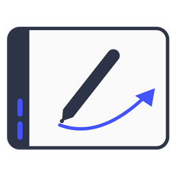
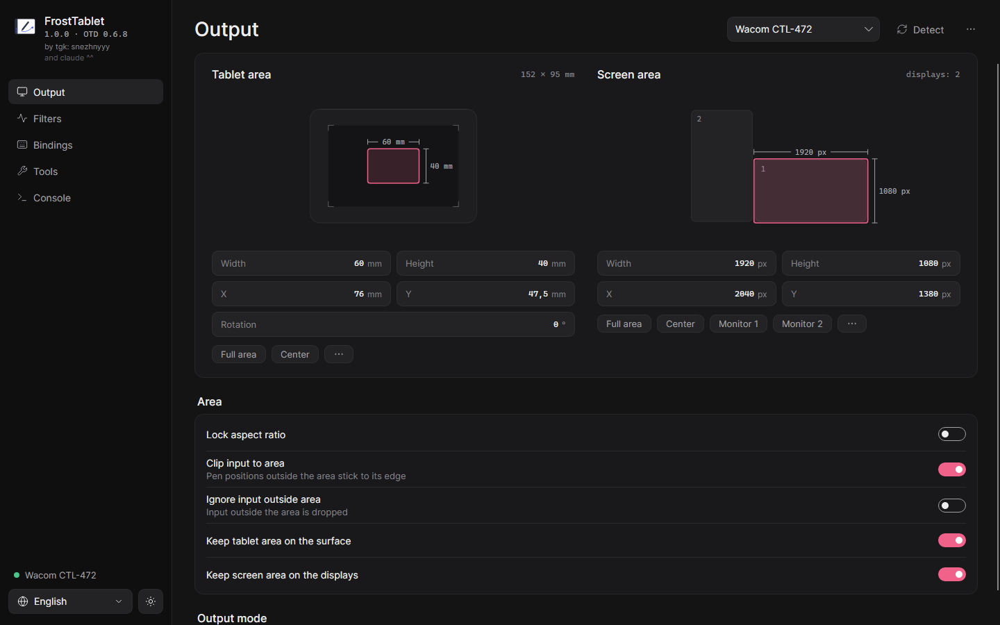
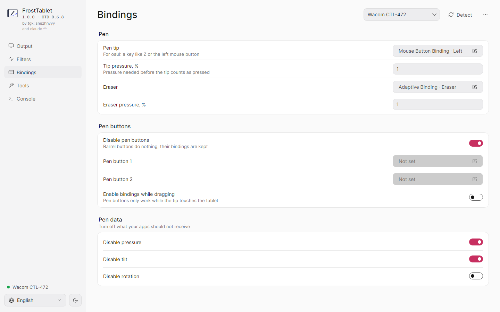
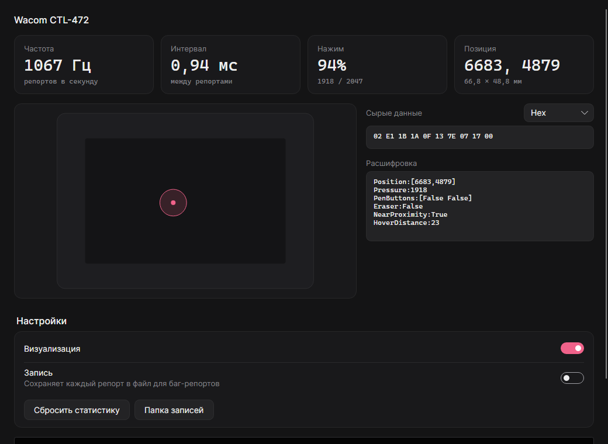

<p align="center">
  
</p>

<h1 align="center">FrostTablet</h1>

<p align="center">
  A faster, cleaner <a href="https://github.com/OpenTabletDriver/OpenTabletDriver">OpenTabletDriver</a> for osu! and everyday pen work.<br>
  <sub>by tgk: snezhnyyy · and claude ^^</sub>
</p>

<p align="center">
  <a href="../../releases/latest"><b>Download</b></a> ·
  <a href="#quick-start">Quick start</a> ·
  <a href="#whats-different">What's different</a> ·
  <a href="#faq">FAQ</a> ·
  <a href="#русский">Русский</a>
</p>

<p align="center">
  
</p>

FrostTablet is a fork of OpenTabletDriver 0.6.x. It keeps everything OTD can do (every supported tablet, all your plugins and filters, your existing settings) and adds a lower-latency input path on Windows, a new interface and a single-file build.

## Download

Grab the file for your system from the **[latest release](../../releases/latest)**:

| System | File | Status |
| --- | --- | --- |
| Windows 10/11 (most PCs) | `FrostTablet-…-win-x64.zip` | ✅ Tested daily |
| Windows on ARM | `FrostTablet-…-win-arm64.zip` | Builds, not tested on hardware |
| Linux (x64) | `FrostTablet-…-linux-x64.tar.gz` | Experimental |
| Linux (ARM64) | `FrostTablet-…-linux-arm64.tar.gz` | Experimental |
| macOS (Apple Silicon) | `FrostTablet-…-osx-arm64.tar.gz` | Experimental |
| macOS (Intel) | `FrostTablet-…-osx-x64.tar.gz` | Experimental |

Each download is **one program file**: the interface and the driver live in the same executable, and .NET is included. There's nothing else to install.

## Quick start

### Windows

1. **Close any other tablet driver.** That means OpenTabletDriver (tray icon → Exit), Wacom/Huion/XP-Pen drivers and other copies of FrostTablet. Two drivers can't use one tablet at the same time.
2. Unzip the download anywhere you like, for example `Desktop\FrostTablet`.
3. Run **`FrostTablet.exe`**. If Windows SmartScreen warns about an unknown app, click *More info → Run anyway*. The app isn't code-signed yet.
4. Plug in your tablet. It's detected automatically, or press **Detect** at the top right.

**Coming from OpenTabletDriver?** FrostTablet reads your settings and plugins from the same place (`%LOCALAPPDATA%\OpenTabletDriver`), so your area, filters and bindings are already there.

**Portable mode:** create a folder named `userdata` next to `FrostTablet.exe`. Settings and plugins are then kept there instead, and your normal OTD setup stays untouched.

### Linux (experimental)

```bash
tar -xzf FrostTablet-*-linux-x64.tar.gz
cd FrostTablet-*-linux-x64
./install.sh        # one time: udev rules, uinput, unloads conflicting kernel drivers (asks for sudo)
./FrostTablet
```

### macOS (experimental)

```bash
tar -xzf FrostTablet-*-osx-arm64.tar.gz
cd FrostTablet-*-osx-arm64
xattr -dr com.apple.quarantine FrostTablet   # the build isn't notarized
./FrostTablet
```

macOS will ask for **Accessibility** and **Input Monitoring** permissions the first time. Allow both in *System Settings → Privacy & Security*.

## First setup for osu!

1. **Output → Tablet area.** Drag the pink rectangle or type exact values (millimetres). *Full area* and *Center* are one click away.
2. **Output → Screen area.** Usually your main monitor: click *Monitor 1*.
3. **Bindings → Pen tip.** Pick *Mouse button → Left*, or a key such as `Z` if you tap with the pen.
4. **Bindings → Pen buttons → Disable pen buttons** if you keep pressing the barrel buttons by accident.
5. **Filters** (optional): smoothing plugins such as Radial Follow or Devocub Antichatter. Install more from **⋯ → Plugin manager**.
6. When you change something, a bar slides in at the bottom:
   - **Apply** tries the change right now. It's lost when the driver restarts.
   - **Save** applies and keeps it.
   - **Reset** goes back to what you had.

Change the **language** (9 languages) and **theme** (moon/sun) at the bottom left. Presets, plugins, the tablet debugger and help are behind **⋯** at the top right.

<p align="center">
  
  
</p>

## What's different

### Input and latency (Windows)

| Change | Why it matters |
| --- | --- |
| **Click no longer fires before the cursor moves.** Bindings run after the new cursor position is sent. | With the pen tip on `Z`/`X`, stock OTD sent the key a report earlier than the cursor move, so taps could register at the previous position. |
| **Pixel-exact cursor.** The absolute-position math is fixed, and sub-pixel precision is kept for raw-input games. | Stock OTD put about 8% of positions one pixel left or up (measured: 156 of 2000 vs 0 of 2000). Addresses upstream #1071. |
| **High-resolution timer** for interpolating filters. It runs on its own MMCSS thread, and fractional rates like 333 Hz or 2000 Hz now work. | At 1000 Hz, 99th-percentile tick lateness dropped from ~1.2 ms to ~0.35 ms. A float-precision bug that made the old fallback timer drift after a few hours is fixed. |
| **The reader thread is boosted (MMCSS)**, and Windows is told not to throttle the driver (EcoQoS / E-cores, timer resolution). | Steadier latency, especially on Intel 12th gen and newer hybrid CPUs. |
| **Key bindings send real scan codes**, including the extended-key flag. | Games that read raw keyboard input see the key. Arrows and PgUp/PgDn work with NumLock on (upstream #3208). |
| **Follows resolution and monitor changes** live. | Games switching resolution no longer offset the cursor (upstream #1143). |
| **No stuck keys.** Everything held is released when the tablet is unplugged or settings are applied. | Upstream #2957. |
| **Less work per report.** HID buffers are reused, and the debugger is serialized off the input thread. | Processing costs about 40 ns per report. The input path never waits for the debugger. |
| **Built-in latency stats.** Once a minute the Console shows the real report rate, interval jitter and driver processing time. | Shows whether your tablet (or its overclock) really runs at the rate you think. |

### Interface

- A completely new app: dark and light themes, a sidebar, live tablet and monitor previews with drafting-style dimensions, and compact number fields (arrow keys and mouse wheel adjust values, Shift for ×10).
- **9 languages:** English, Русский, Українська, Español, Português, Deutsch, Français, 中文, 日本語.
- **Disable pen buttons** switch. Your bindings are kept.
- A clear **Reset / Apply / Save** bar that only appears when something changed.
- A redesigned tablet debugger with live report rate in Hz, interval, pressure and position.
- Updates are checked against **this** repository, never against upstream. Installing upstream would replace FrostTablet.
- One self-contained executable instead of ~260 files.

## FAQ

**Will my OpenTabletDriver plugins work?** Yes. FrostTablet is OTD 0.6.x inside, and plugins built for 0.6 load as usual.

**My tablet isn't detected.** Make sure no other tablet driver is running, including OTD in the tray and vendor drivers, then press **Detect**. The status at the bottom left says *Another driver is running* if a different OTD daemon is active.

**How do I go back to OpenTabletDriver?** Exit FrostTablet from the tray and start OTD. Your settings stay compatible.

**Where are my settings?** In `%LOCALAPPDATA%\OpenTabletDriver` (Windows), `~/.config/OpenTabletDriver` (Linux) or `~/Library/Application Support/OpenTabletDriver` (macOS). In portable mode they're in the `userdata` folder next to the executable.

**What do the Performance lines in the Console mean?** For example: `1000 reports/s, interval p50 1000 µs / p99 1060 µs, pipeline p50 6 µs / p99 18 µs`. That's the real report rate, how even the reports are, and how long FrostTablet itself takes per report.

**Is this affiliated with OpenTabletDriver?** No. It's a community fork. Report FrostTablet bugs **here**, not upstream.

## Building from source

Requires the [.NET 10 SDK](https://dotnet.microsoft.com/download).

```bash
git clone https://github.com/snezhnyyy/OTD-FrostTablet
cd OTD-FrostTablet
dotnet run --project OpenTabletDriver.UX.Avalonia -c Release
# single-file release build:
dotnet publish OpenTabletDriver.UX.Avalonia -c Release -r win-x64 --self-contained \
  -p:PublishSingleFile=true -p:IncludeNativeLibrariesForSelfExtract=true -p:EnableCompressionInSingleFile=true
```

Pushing a tag like `v1.0.1` builds every platform on GitHub Actions and publishes a release (`.github/workflows/frost-release.yml`).

## Credits and license

- **[OpenTabletDriver](https://github.com/OpenTabletDriver/OpenTabletDriver)** by InfinityGhost, X9VoiD and contributors. FrostTablet is built on it and remains under **LGPL-3.0**, see [LICENSE](LICENSE).
- [Avalonia](https://avaloniaui.net) (MIT), [Inter](https://rsms.me/inter/) font (OFL), [Lucide](https://lucide.dev) icons (ISC).
- Visual direction guided by *unslop* by Damir Sokolovsky ([@heydamir](https://x.com/heydamir)), CC BY 4.0.
- **AI disclosure:** large parts of this fork were written with AI assistance (Claude, with help from Codex), directed and tested by snezhnyyy.

---

## Русский

**FrostTablet** — это форк OpenTabletDriver 0.6.x. Он умеет всё то же, что OTD: поддерживает все планшеты, работает с твоими плагинами, фильтрами и настройками. Сверху добавлены ускоренный ввод на Windows, новый интерфейс и сборка одним файлом.

### Установка (Windows)

1. **Закрой все другие драйверы планшета**: OpenTabletDriver (трей → выход), драйверы Wacom, Huion, XP-Pen и другие копии FrostTablet.
2. Скачай `FrostTablet-…-win-x64.zip` из **[последнего релиза](../../releases/latest)** и распакуй куда угодно.
3. Запусти **`FrostTablet.exe`**. Если SmartScreen ругается, нажми *Подробнее → Выполнить в любом случае*: у программы пока нет цифровой подписи.
4. Подключи планшет. Он найдётся сам, а если нет, нажми **«Найти планшет»** справа вверху.

**Переходишь с OpenTabletDriver?** FrostTablet берёт настройки и плагины из того же места (`%LOCALAPPDATA%\OpenTabletDriver`), так что область, фильтры и бинды уже на месте.

**Портативный режим:** создай рядом с `FrostTablet.exe` папку `userdata`. Тогда настройки будут храниться в ней, а обычный OTD останется нетронутым.

### Первая настройка под osu!

1. **Вывод → Область планшета.** Перетащи розовый прямоугольник или введи точные размеры в миллиметрах.
2. **Вывод → Область экрана.** Обычно достаточно нажать «Монитор 1».
3. **Привязки → Кончик пера.** Выбери «Кнопка мыши → Left» или клавишу, например `Z`.
4. **Привязки → Кнопки пера → «Отключить кнопки пера»**, если случайно жмёшь кнопки на корпусе.
5. **Фильтры** (по желанию): Radial Follow, Antichatter и другие. Новые ставятся через **⋯ → Менеджер плагинов**.
6. Когда что-то меняешь, снизу выезжает панель:
   - **«Применить»** пробует изменения сейчас, но после перезапуска драйвера они пропадут.
   - **«Сохранить»** применяет и оставляет навсегда.
   - **«Сбросить»** возвращает как было.

Язык (9 языков) и тема (луна или солнце) переключаются внизу слева. Пресеты, плагины, отладчик и справка спрятаны под кнопкой **⋯** справа вверху.

### Что улучшено

- **Клик больше не раньше движения.** Если кончик пера забинжен на клавишу, нажатие раньше уходило в систему до того, как курсор переедет. Теперь сначала движение, потом клик.
- **Точный пиксель.** Раньше примерно 8% позиций курсора попадали на пиксель левее или выше нужного.
- **Точный таймер** для фильтров с интерполяцией, плюс приоритет MMCSS для потока ввода. Windows больше не урезает драйверу производительность и не загоняет его на E-ядра.
- **Настоящие сканкоды клавиш.** Игры с raw input видят нажатия, а стрелки работают при включённом NumLock.
- **Смена разрешения экрана подхватывается на лету.** Залипших клавиш при отключении планшета больше нет.
- **В «Консоли» раз в минуту видна реальная частота планшета и задержка драйвера.** Удобно проверить, работает ли разгон до 1000 Гц.

### Частые вопросы

- **Плагины от OTD работают?** Да, внутри FrostTablet всё тот же OTD 0.6.
- **Планшет не находится.** Проверь, что не запущен другой драйвер, и нажми «Найти планшет». Внизу слева будет написано «Работает другой драйвер», если мешает чужой OTD.
- **Как вернуться на OTD?** Закрой FrostTablet из трея и запусти OTD. Настройки совместимы.
- **Куда писать о багах?** В Issues **этого** репозитория, а не в оригинальный OTD.
